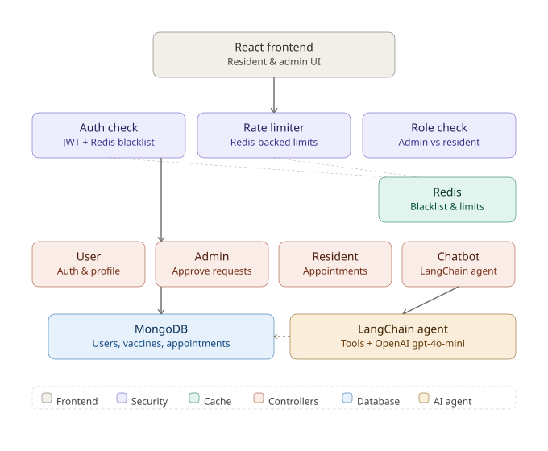

<div align="center">


# 💉 EpiShield — Vaccine Management Platform

### *Track diseases · Manage vaccines · Book appointments · Ask an AI assistant*

**A full-stack public-health platform where residents request vaccination coverage and appointments, and admins govern what's approved — with an AI chatbot that answers questions grounded in live disease and vaccine data.**

</div>

---

## 📌 Problem Statement

Public vaccine and disease-tracking systems usually fall into one of two traps: either anyone can edit critical health data with no oversight, or the system is so locked down that residents can't participate at all.

**The core problems this platform solves:**

- 🛂 **Trust boundary** — Residents need to contribute (report a disease outbreak, request a new vaccine) without being able to unilaterally publish unverified health data
- 📅 **Scheduling chaos** — Vaccination appointments need real conflict prevention, not "hope nobody double-books"
- ✅ **Accountability** — A vaccination should only be marked "completed" by someone authorized to confirm it happened, not self-reported by the patient
- 🤖 **Information access** — Residents have questions ("which vaccine covers dengue?", "what diseases are active in my city?") that shouldn't require digging through admin dashboards
- 🔐 **Data integrity** — Password storage, role assignment, and session handling all need to be done correctly, not just functionally

**EpiShield solves this with a two-tier trust model**: residents *propose*, admins *approve* — enforced at the API layer, not just hidden in the UI.

---

## 💡 Approach

The system is built around one central design decision: **write access is asymmetric by role.**

### Tier 1 — Admin-authored data (auto-approved)
When an admin adds a disease or vaccine, it's live immediately — admins are the trusted source of truth.

### Tier 2 — Resident-authored data (approval-gated)
When a resident submits a new disease report or vaccine suggestion, it lands in a separate `*Request` collection. It has **zero effect on the live, searchable dataset** until an admin reviews and approves it — at which point it's merged into the approved collection.

### Appointment lifecycle (three states, asymmetric permissions)
```
scheduled → completed   (admin-only — patients cannot self-certify their own vaccination)
scheduled → canceled    (resident-only, on their own appointment)
```
A compound unique index (`resident + vaccine + scheduledAt`) prevents duplicate bookings at the database level, not just in application code.

### AI Assistant (tool-calling agent)
Rather than a static FAQ bot, the chatbot is a LangChain `AgentExecutor` with **custom Tools** that query live MongoDB data — disease search, vaccine search, vaccine-for-disease lookup, and disease-by-city — so answers reflect the current approved dataset, not a stale knowledge snapshot.

---

## 🏗️ Architecture


## 📸 Screenshots

### 🏠 Resident Home


### 🏠 Resident Appointment


### 🏠 Admin Home


### 🏠 Admin Appointment


### 📜 Chat Assistant


---
## 🚀 Live Demoop

**Frontend:** https://vaccine-management-platform.vercel.app/

**Backend API:** https://vaccine-management-platform.onrender.com

---

## 📁 Project Structure

```
Vaccine-Management-Platform/
│
├── backend/
│   ├── server.js                    # Entry point — connects DB/Redis, then boots the app
│   ├── app.js                       # Express app — middleware & route wiring
│   │
│   ├── Models/
│   │   ├── User.js                  # bcrypt pre-save hook, role enum, select:false password
│   │   ├── Vaccine.js / Disease.js  # Approved, live data
│   │   ├── vaccineReq.js / diseaseReq.js  # Pending resident submissions
│   │   └── Appointment.js           # Compound unique index (resident+vaccine+time)
│   │
│   ├── Controllers/
│   │   ├── User.js                  # Register (resident-only), login, session (/me), profile
│   │   ├── Admin.js                 # Approve/reject requests, direct add, appointment completion
│   │   ├── Resident.js              # Submit requests, book/cancel/reschedule appointments
│   │   └── Chatbot.js               # LangChain AgentExecutor + custom Tool definitions
│   │
│   ├── Middlewares/
│   │   ├── auth.js                  # JWT verification + Redis blacklist check
│   │   ├── rateLimiters.js          # Per-route Redis-backed rate limits
│   │   └── error.js / catchAsyncErrors.js
│   │
│   ├── Routes/                      # userRoutes · adminRoutes · residentRoutes · chatbotRoutes
│   ├── Database/                    # dbConnection.js · redisConnection.js
│   └── utils/                       # jwtToken.js · tokenBlacklist.js
│
└── frontend/
    └── src/
        ├── components/
        │   ├── Auth.jsx              # Auth context — session restore via /api/users/me
        │   ├── Chatbot.jsx           # Floating assistant widget (auth-gated)
        │   ├── forms/                # VaccineForm / DiseaseForm (mode-aware: admin vs resident)
        │   └── search/               # SearchBar, VaccineList, DiseaseList
        │
        ├── pages/
        │   ├── admin/                # Dashboard, Requests, Pending*, Appointments (mark-completed)
        │   └── resident/             # Add Vaccine/Disease, Appointments, Search
        │
        └── App.jsx                  # Role-based route protection
```

---

## ✨ Features

| Feature | Description |
|---|---|
| 🔐 Secure Auth | bcrypt-hashed passwords, JWT in `httpOnly` cookies, session restore on refresh |
| 🛡️ Role-Based Access | Resident vs Admin, enforced server-side at every write endpoint |
| 📝 Two-Tier Approval | Residents propose diseases/vaccines → admins approve before they go live |
| 📅 Appointment Booking | Book, reschedule, cancel — with DB-level duplicate-booking prevention |
| ✅ Admin-Confirmed Completion | Only admins can mark a vaccination "completed" — residents can't self-certify |
| 🤖 AI Assistant | LangChain tool-calling agent, answers grounded in live approved data |
| 🚦 Rate Limiting | Redis-backed, tuned per route (strict on login/chatbot, generous on reads) |
| 🚪 True Logout | Redis token blacklist — a logged-out token is rejected immediately, not just cookie-cleared |
| 🔍 Location-Aware Search | Find vaccines by the diseases active in a given city |
| 🎨 Responsive UI | React + Tailwind, role-aware navigation and dashboards |

---

## 🧠 Tech Stack

| Layer | Technology | Purpose |
|---|---|---|
| Frontend | React 18 + Vite | UI, fast dev server |
| Styling | Tailwind CSS | Utility-first responsive styling |
| Routing | React Router v7 | Client-side routing, role-gated routes |
| HTTP Client | Axios | Cookie-based authenticated requests |
| Icons | Lucide React | UI iconography |
| Backend | Express (ESM) | REST API |
| Database | MongoDB + Mongoose | Primary data store, schema validation |
| Cache / Store | Redis | Token blacklist + rate-limit counters |
| Auth | JWT + bcryptjs | Stateless sessions, salted password hashing |
| Rate Limiting | express-rate-limit + rate-limit-redis | Per-route abuse protection |
| AI Orchestration | LangChain (LCEL, AgentExecutor) | Tool-calling agent for the chatbot |
| LLM | OpenAI `gpt-4o-mini` | Chatbot reasoning + tool selection |

---

## 🚀 Getting Started

### Prerequisites

- Node.js 18+
- MongoDB (local or Atlas)
- Redis (local or managed)

```bash
# macOS
brew install redis && brew services start redis
# or via Docker
docker run -d -p 6379:6379 redis
```

### 1. Clone the repository

```bash
git clone https://github.com/Sushpal/Vaccine-Management-Platform.git
cd Vaccine-Management-Platform
```

### 2. Backend setup

```bash
cd backend
npm install
cp config/config.example.env config/config.env
```

Fill in `config/config.env`:

```env
MONGO_URI=mongodb://127.0.0.1:27017/vaccine-management
PORT=4000
FRONTEND_URL=http://localhost:5173

JWT_SECRET_KEY=<generate with: openssl rand -hex 32>
JWT_EXPIRE=10d
COOKIE_EXPIRE=5

REDIS_URL=redis://127.0.0.1:6379

OPENAI_API_KEY=your_openai_api_key_here
```

```bash
npm run dev
```

You should see, in order: `Connected to Redis successfully!` → `Connected to MongoDB successfully!` → `Server running at port 4000`.

### 3. Frontend setup

```bash
cd ../frontend
npm install
npm run dev
```

Open `http://localhost:5173` 🎉

### 4. Create your first admin account

Public registration always creates a `resident` account by design (see [Security Notes](#-security-notes)). To create an admin:

```bash
mongosh
use vaccine-management
db.users.updateOne({ email: "you@example.com" }, { $set: { role: "admin" } })
```

---

## 🔒 Security Notes

- **Passwords** are hashed with bcrypt via a Mongoose `pre("save")` hook — never stored or compared as plain text. The field is `select: false` by default, so it's never accidentally leaked in a query response.
- **Role assignment is server-enforced.** Public registration ignores any `role` field sent in the request body — every self-registered account is a `resident`, regardless of what the client sends. Admin accounts must be provisioned separately.
- **JWTs live only in `httpOnly` cookies** (never duplicated into the JSON response body), with `secure`/`sameSite` flags set appropriately per environment.
- **Logout is a real revocation, not just a cookie clear** — the token is added to a Redis blacklist with a TTL matching its remaining validity, so a copied/stolen token stops working the moment the user logs out.
- **Every sensitive route is rate-limited** — login (5/15min), registration (10/hour), chatbot (15/15min per user), and resident write actions (20/15min per user), backed by Redis so limits hold even across multiple server instances.
- **User-supplied input never reaches a MongoDB `$regex` unescaped** — all chatbot search tools and admin/resident search endpoints escape regex metacharacters to prevent ReDoS and pattern-injection.
- **Appointment completion is admin-only** — the API rejects a resident attempting to set their own appointment status to `completed`, closing a self-certification loophole.

---

## 🐛 Known Limitations

- Appointment de-duplication relies on an exact-timestamp compound index — two bookings for the same slot seconds apart at the same clinic aren't currently caught by any additional business-rule layer
- No automated test suite yet (unit or integration)
- Rate limiter keys fall back to IP for unauthenticated routes, which can be shared across users behind NAT/corporate proxies
- The chatbot's tool-based search is only as current as the approved dataset — pending (unapproved) requests are intentionally invisible to it

---

## 🗺️ Roadmap

- [ ] Automated test suite (Jest/Supertest for backend, Vitest for frontend)
- [ ] Email notifications for appointment reminders and request approvals
- [ ] Audit log for admin approve/reject/complete actions
- [ ] Pagination on admin list views (users, requests, appointments)
- [ ] Dockerized local dev environment (Mongo + Redis + backend + frontend in one `docker-compose up`)
- [ ] CI pipeline (lint + test on PR)

---

## 🤝 Contact

For suggestions, feedback, or collaboration:

- GitHub: https://github.com/Sushpal
- Email: nenavathsushpal4@gmail.com

---

<div align="center">

**Built as a full-stack MERN project with a security-first backend audit and an AI-assisted admin workflow.**

<sub>Powered by MongoDB · Express · React · Redis · LangChain · OpenAI</sub>

</div>